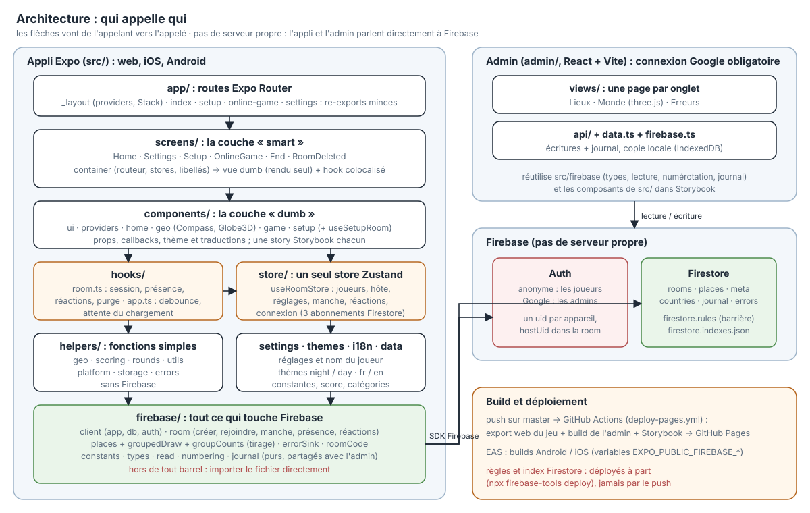
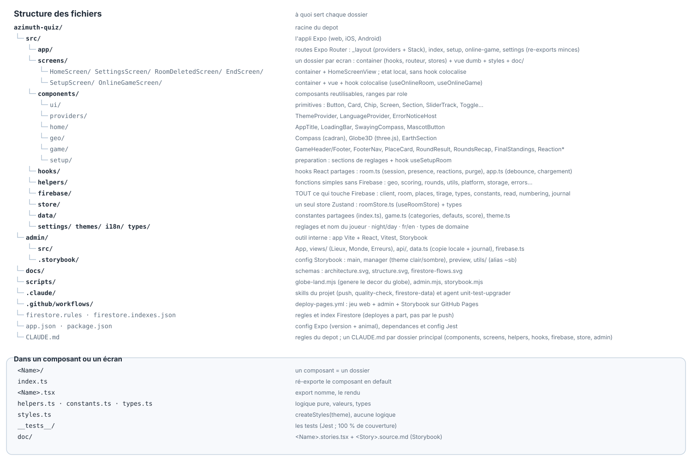
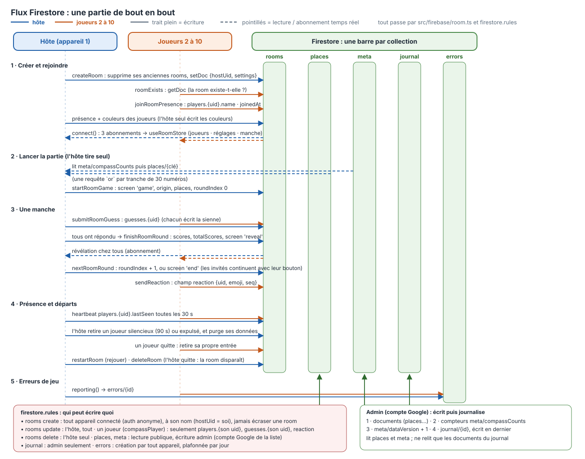

# Azimuth Quiz

🔗 **[Jouer dans le navigateur](https://mathieujullien77190.github.io/azimuth-quiz/)**
· 🗺️ **[Admin des données](https://mathieujullien77190.github.io/azimuth-quiz/admin/)**
· 🧩 **[Storybook](https://mathieujullien77190.github.io/azimuth-quiz/storybook/)**

Jeu de géographie **Boussole**, jusqu'à 10 joueurs (un téléphone par joueur) et 20 manches : un lieu s'affiche, vise-le
avec la boussole et estime la distance depuis ton point de départ (GPS, ou Paris par défaut). Tout le monde répond en
même temps, puis révélation.

## Jouer

Toute partie est une **room en ligne**, sans compte (identité anonyme Firebase). Solo : « Lancer la partie »
crée une room cachée dont tu es le seul joueur. À plusieurs : l'hôte règle et lance, les autres rejoignent avec
le code affiché dans l'en-tête. Qui perd la connexion quitte la partie. Thèmes nuit et jour, français et anglais.

## Lancer en local

```bash
npm install
npx expo start        # menu Expo (web / iOS / Android)
npx expo start --web  # directement le web
npm run admin         # l'admin des données
npm run stories     # les composants
```

```bash
npx tsc --noEmit
npx expo lint
npm run test:coverage   # seuil de couverture : 100 %
```

Les rooms demandent la configuration Firebase (variables `EXPO_PUBLIC_FIREBASE_*`) et les règles de
`firestore.rules`, à déployer à part : `npx firebase-tools deploy --only firestore:rules`.

## Données

Lieux, devinettes et métiers vivent dans **Firestore** (aucun fichier de données dans l'appli).
L'admin (React + Vite, une page par onglet : lieux, métiers, jeux de mots) se connecte avec un
compte Google déclaré dans `firestore.rules` et enregistre chaque modification directement. Les données étant
dupliquées, elles se modifient par l'admin ou en suivant le skill `.claude/skills/firestore-data`.

## Déploiement

Un push sur `master` publie le jeu web, l'admin (`/admin/`) et Storybook sur GitHub Pages
(`.github/workflows/deploy-pages.yml`). Règles et index Firestore ne sont pas déployés par ce push.

## Architecture

Pas de serveur propre : l'appli Expo et l'admin Vite parlent directement à Firebase (Auth et Firestore, règles dans
`firestore.rules`). Un push sur `master` construit le web, l'admin et Storybook vers GitHub Pages.

### Qui appelle qui

Les couches de l'appli (routes, écrans, composants, hooks, store, helpers, `firebase/`), l'admin, Firebase et le déploiement.



### Structure des fichiers

À quoi sert chaque dossier, et ce que contient un composant.



### Flux Firestore

Une partie de bout en bout : créer et rejoindre, lancer, une manche, présence et départs, erreurs. Bleu = l'hôte, orange = les
autres joueurs ; une barre par collection.



## Stack et structure

Expo (SDK 57) + Expo Router, React Native + react-native-web, TypeScript, Zustand, Firebase (Firestore + auth
anonyme), Jest + Testing Library, Storybook. Un composant = un dossier (`index.ts`, `<Nom>.tsx`, `helpers.ts`,
`constants.ts`, `types.ts`, `styles.ts`), alias `@/` → `src/`. L'architecture, le jeu et les pièges connus sont
dans [`CLAUDE.md`](CLAUDE.md).
